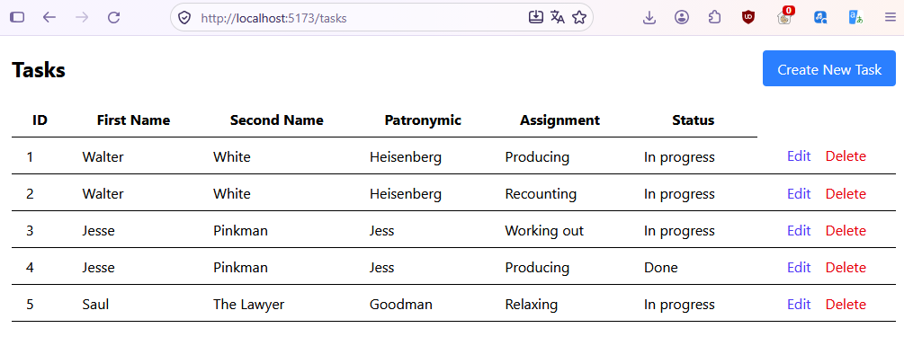
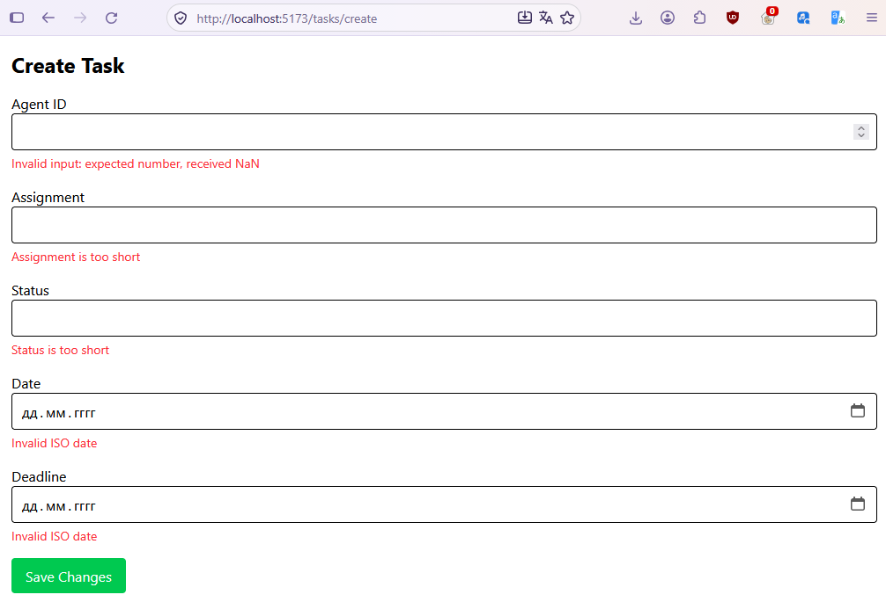
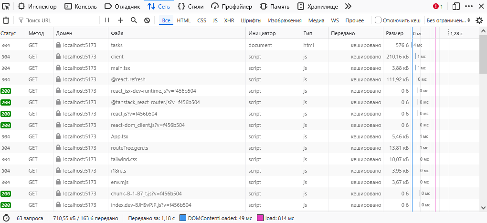
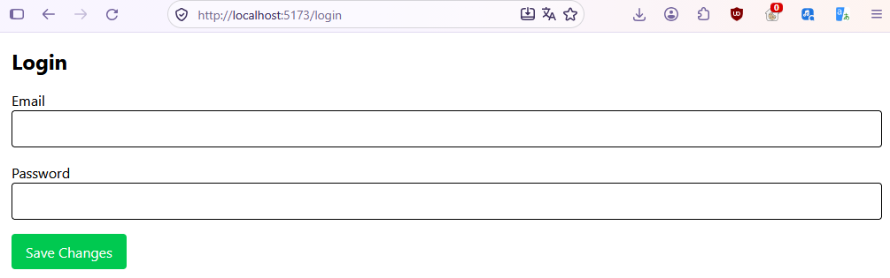

# КПЗ

## Опис Функціоналу

- Створення Agents та Tasks
- Перегляд списків Agents та Tasks
- Редагування Agents та Tasks
- Видалення Agents та Tasks
- Автентифікація за Email та Password
- Збереження JWT токена
- Відсилання JWT токена
- Отримання JWT токена

## Приклади Ключового Коду

Конфігурація Axios
```
import axios from 'axios';
import { useAuthStore } from "@/store/auth-store";

// Створення окремого інстансу Axios
const apiClient = axios.create({
  baseURL: import.meta.env.VITE_API_BASE_URL,
  headers: {
    'Content-Type': 'application/json',
  },
});

// Якщо токен доступний у змінній середовища -- додаємо в Authorization
const token = import.meta.env.VITE_API_AUTH_TOKEN;
if (token) {
  apiClient.defaults.headers.common['Authorization'] = `Bearer ${token}`;
}

// Інтерцептор для відправки JWT
apiClient.interceptors.request.use(
    (config) => {
        const token = useAuthStore.getState().token;

        if (token) {
            config.headers.Authorization = `Bearer ${token}`;
        } else {
            delete config.headers.Authorization;
        }

        return config;
    },
    (error) => Promise.reject(error)
);

// Інтерцептор для відповіді (обробка помилок)
apiClient.interceptors.response.use(
  (response) => response,
  (error) => {
    // Тут можна додати глобальну обробку помилок
    console.error('API Error:', error.response?.data || error.message);
    // Можна також виводити повідомлення користувачу через toast
    // toast.error(error.response?.data?.message || 'Unknown error');
    return Promise.reject(error);
  }
);
export default apiClient;
```

Хуки для TanStack Query
```
// Хуки для використання в компонентах
export const useTasks = () => useQuery<TaskDTO[]>({ queryKey: ['tasks'], queryFn: getTasks });

export const useTask = (id: string) => useQuery<TaskDTO>({ queryKey: ['tasks', id], queryFn: () => getTaskById(id) });

export const useCreateTask = () => {
    const queryClient = useQueryClient();
    const navigate = useNavigate();

    return useMutation({
        mutationFn: createTask,
        onSuccess: () => {
            queryClient.invalidateQueries({ queryKey: ['tasks'] });
            navigate({ to: '/tasks' });
        },
    });
};

export const useUpdateTask = () => {
    const queryClient = useQueryClient();
    const navigate = useNavigate();

    return useMutation({
        mutationFn: updateTask,
        onSuccess: (updatedTask) => {
            queryClient.invalidateQueries({ queryKey: ['tasks'] });
            queryClient.setQueryData(['tasks', updatedTask.id], updatedTask);
            navigate({ to: '/tasks' });
        },
    });
};

export const useDeleteTask = () => {
    const queryClient = useQueryClient();

    return useMutation({
        mutationFn: deleteTask,
        onSuccess: () => {
            queryClient.invalidateQueries({ queryKey: ['tasks'] });
        },
    });
};
```

Схема Zod
```
const taskSchema = z.object({
	agent_id: z.number().positive("Task must be a positive number"),
	assignment: z.string().min(1, "Assignment is too short"),
	status: z.string().min(1, "Status is too short"),
	date: z.iso.date(),
	deadline: z.iso.date(),
});
```

## Скріншоти

Сторінка зі списком сутностей


Форма з помилками валідації від Zod


Вкладка Network у DevTools


Сторінка логіну


# Посилання на репозиторій

[Репозиторій](https://github.com/DialloDan/lab5)